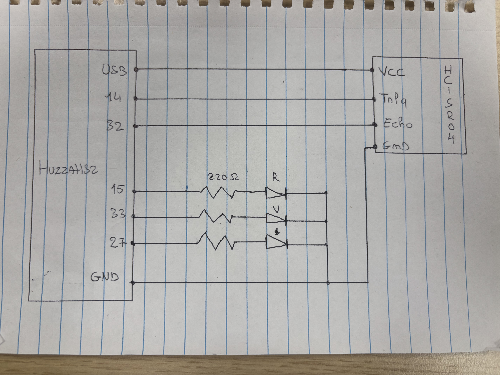
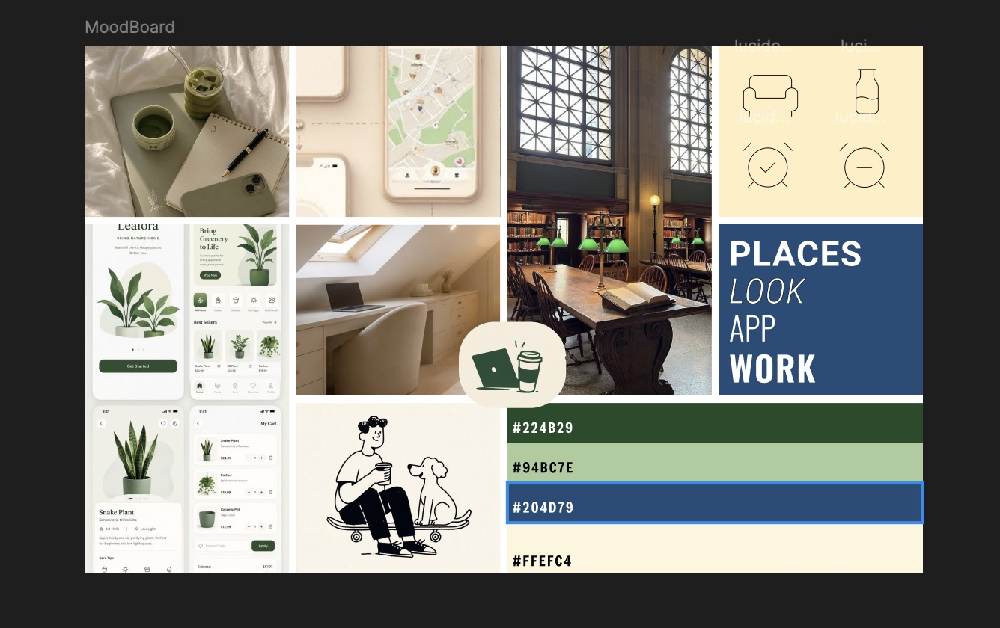
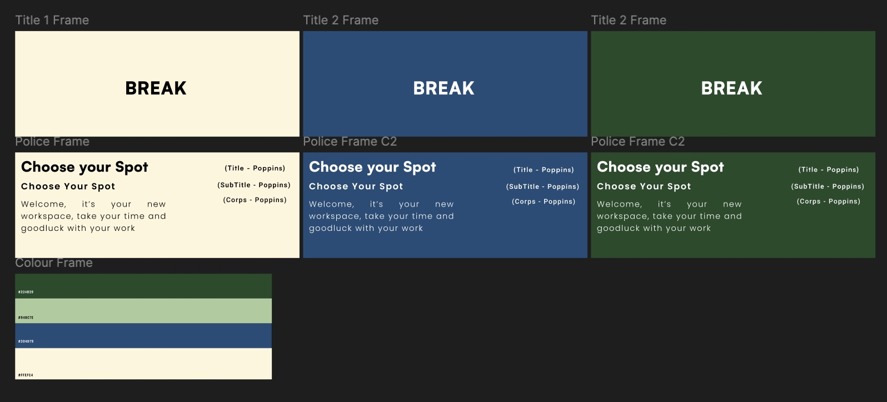
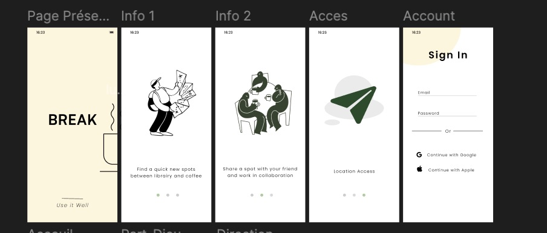
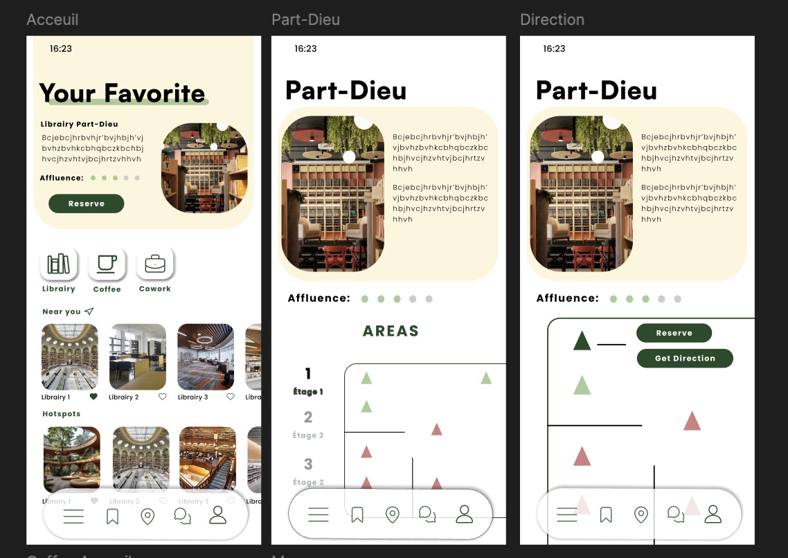
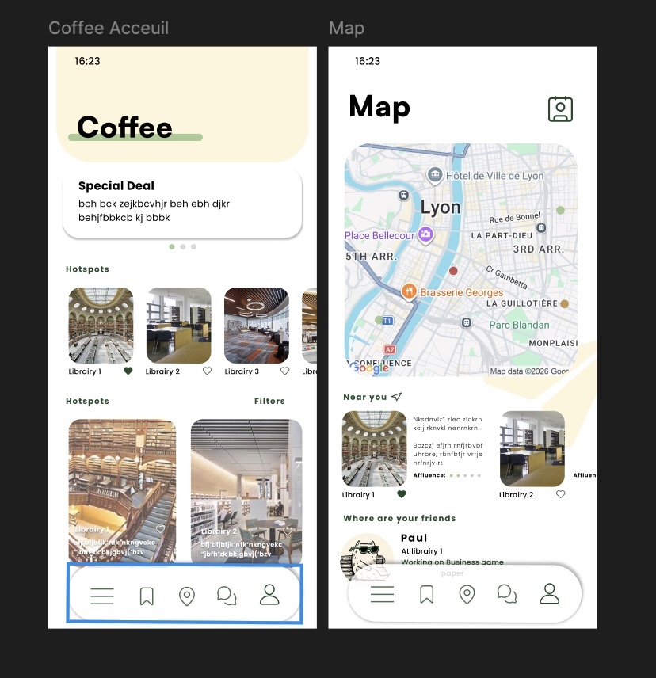
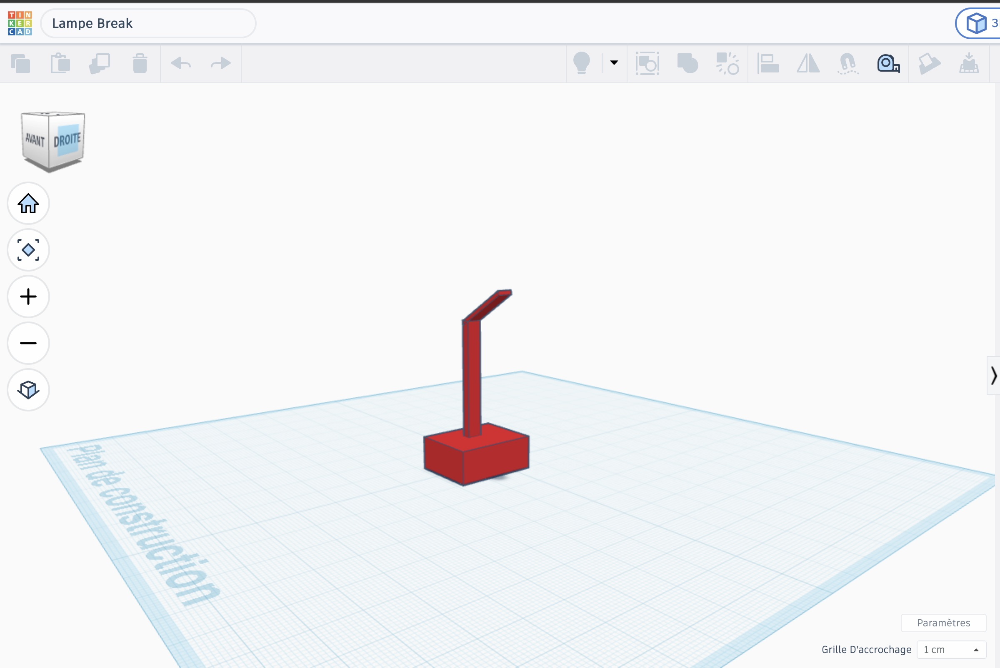
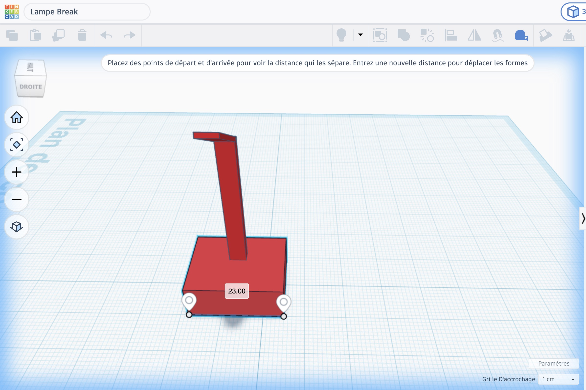
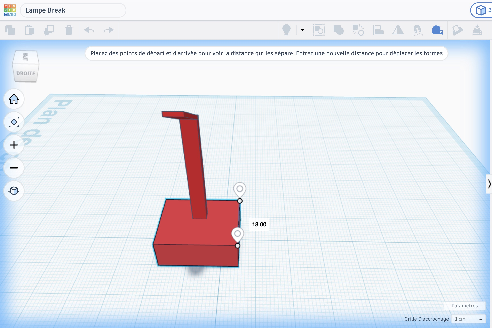
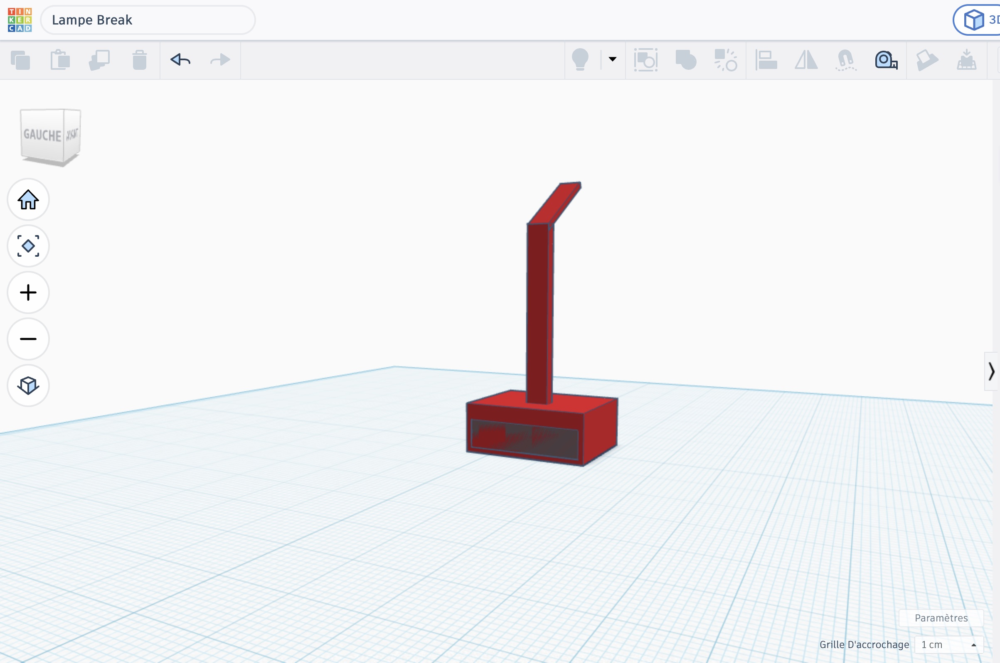

# Shak Project: BREAK

## Introduction

*BREAK* is a project inspired by parking lot indicators. It aims to help people find great places to work and explore.
The idea is to install a sensor on each table that sends a message to the app indicating whether the table is available.

Voici la table des matières de mon rendu:
•⁠  ⁠[Code of the electronic part↗️](#adafruit-io-code)
•⁠  ⁠[schematic view](#schematic-view)
•⁠  ⁠[Moodboard](#moodboard)
•⁠  ⁠[UI on figma](#figma-ui)
•⁠  ⁠[Code of the web part↗️](#web-part)
•⁠  ⁠[Video](#video)

## Schematic view
Here find the schematic view of my hardware. 

<picture>
    
</picture>

This prototype uses an HC-SR04, which is our presence captor, a LED light to display a color wether the place is occupied or not and it finally includes an microcontroller board (Huzzah32).

## Adafruit IO Code

Find the code below:
[Adafruit_Break Code](Huzzah32/Adafruit_break)

Find the config below:
[Adafruit_Break Code](Huzzah32/config)

## Moodboard

Find the original moodboard of the app below: 

<picture>
    
</picture>

And here the first composition for the font and the background color:

<picture>
    
</picture>

## Figma UI

Find below the figma screenshots of the mockups of the app:

First page and the first connexion ones.

<picture>
    
</picture>

The home page with the details of a page for one location (here maker's board).

<picture>
    
</picture>

Other pages for future features.

<picture>
    
</picture>

>[!TIP]
 ⁠ [figma UI↗️](https://www.figma.com/design/lGl6LsY7FcwCob6b3MuNoX/Shak_DWW_Project?node-id=16-370&t=Q8vTxWmrafFvzUd8-1) ⁠

Below, you can also find some screenshots of the potential lamp use to hide the prototype:

<picture>
    
</picture>

Length and width of the lamp:

<picture>
    
</picture>

<picture>
    
</picture>

The hole position to insert the captor:

<picture>
    
</picture>

## Web part

Here is a preview of the assignment. 

[See the video of the web app](https://youtube.com/shorts/yusJ6bSYPxc)

## Video

[See the video on youtube↗️](https://you